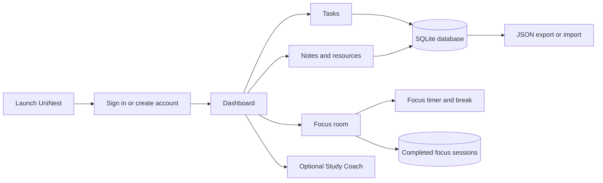

# UniNest — Personal Study Planner

UniNest is a personal study workspace for turning schoolwork into manageable next steps. It brings task planning, notes, useful links, and focused study sessions together in one calm interface. The app runs locally on your computer and saves each account’s planner data in SQLite.

> **Testing build — Baz:** UniNest is currently being tested as a locally hosted prototype, not a production service. This version uses Flask’s built-in development server at `127.0.0.1:8000`, local SQLite files (`study_planner.db` and `study_planner_demo.db`), seeded demo data and a demo sign-in (`demo@uninest.local` / `uninest-demo`), an automatically generated local session-secret file (`.uninest-session-key`), and OpenRouter’s changeable free-model router (`openrouter/free`). An OpenRouter key entered in Study Coach is held in server memory only until the app closes. These are temporary testing choices; the demo account and sample content are for presentation only. Do not expose the local development server to the public internet or use real sensitive data in the demo account.

## What’s included

### Overview

- Dashboard with task progress, completed and pending counts, note/resource totals, and a quick-add task field.
- A personalized greeting uses the signed-in user’s first name and the browser’s local time.
- Shortcuts to your tasks and Focus room.

### Tasks

- Create, complete, and delete tasks.
- Set a priority, optional due date, and estimated study time.
- Filter the task list by subject.
- See due work grouped into today and overdue, the next seven days, and later or unscheduled.
- Search and filter the list by all, pending, or completed tasks.
- Select an unfinished task in Focus room to keep your current goal visible.

### Subjects

- Create a course from the Subjects page without first making a task.
- Add and complete that course’s tasks in its on-page workspace, or choose it from the task form’s subject list.
- Older task subject names are brought into the subject list automatically on startup.

### Notes and resources

- Save and delete notes for class ideas, reminders, and revision material.
- Keep links in a resource shelf and label them as links, PDFs, videos, articles, or tools.

### Focus room

- Focus sessions of 15, 25, or 50 minutes.
- A five-minute break starts when a focus session finishes; the break can be paused, reset, or skipped.
- A completion chime plays at the end of a focus session or break when sounds are enabled.
- Choose a task to focus on, and use the full-screen timer for a distraction-reduced view.
- Completed focus sessions are logged against the selected task and summarized over the last seven days.

### Personalization and accounts

- Register, sign in, edit your name and email, and change your password.
- Warm dark and light themes, with page transitions and animated decorative artwork.
- Settings to switch interface sounds, animations, and motion blur on or off, and adjust blur strength.
- Restore default settings to reset the theme and sensory preferences without changing planner records.
- Button sounds are generated in the browser; no audio files are required. Sound and motion preferences are saved to the signed-in account.

### Export and import

- Export planner tasks, notes, resources, theme, and display preferences to a JSON backup.
- Backups include the subject list and completed focus-session history.
- Import a UniNest JSON backup. Imported records are added to the current account; existing records are kept.
- Backups do not include passwords, account details, AI credentials, or the current timer countdown.

### Study Coach — chat and quick plans

Study Coach now supports a short, multi-turn conversation as well as a structured quick plan. Ask a question directly or optionally link unfinished tasks from your planner for context. Chat replies stream into the page as the model writes. Chat history stays in the current browser session and is not saved to your account. With explicit chat consent, the message history and selected task details are sent to OpenRouter; notes, resources, name, and email are not sent.

The conversation is available from the shared top bar throughout the planner, except in Focus room. It opens as a side workspace on larger screens and an inline chat workspace on smaller screens, keeping the conversation close without covering the planner.

The quick-plan tool uses unfinished tasks, available study time, and a stress check-in. With explicit opt-in, chat and quick plans can use OpenRouter's free-model router (`openrouter/free`); free model availability and rate limits vary. Without a key or AI consent, the quick planner makes a basic plan locally. If OpenRouter is unavailable, quick planning falls back to the private plan. A key appears as saved until the first request verifies that it works. Study Coach suggestions are for study planning, not medical advice or therapy.

## How the app works



## Technology

- **Server and application logic:** Python with Flask
- **Database:** SQLite
- **Browser interface:** HTML, CSS, and JavaScript
- **Python package:** Flask, listed in `requirements.txt`
- **Optional AI provider:** OpenRouter; internet access and an API key are needed only for AI-generated plans

Python runs the local web server and handles authentication, database operations, exports, imports, and Study Coach requests. HTML, CSS, and JavaScript provide the browser interface and its interactive behavior. No separate database server or front-end build step is needed.

## Project files

```text
PQC_Project/
├── app.py                 Flask routes, account logic, SQLite access, import/export, Study Coach
├── main.py                Starts the local server and opens the browser
├── legacy_desktop.py      Earlier desktop prototype; not used by the current web launchers
├── requirements.txt       Python dependencies
├── run_app.bat            Starts your regular planner
├── run_demo.bat           Starts the sample-data presentation version
├── templates/
│   ├── auth.html          Sign-in and registration screen
│   └── index.html         Planner, settings, account, and project information pages
└── static/
    ├── app.css            Planner layout, themes, artwork, responsive styles, and motion
    ├── app.js             Planner interactions, timer, sounds, and browser-side logic
    ├── auth.css           Sign-in and registration styling
    └── auth.js            Sign-in and registration interactions
```

The regular and demo SQLite databases are created locally when needed and are not source-code files. The virtual environment, `.env` files, session secret, database files, and exported backup files are excluded from Git by `.gitignore` (`.env.example` may be committed as a template). JSON export/import also includes task subjects and completed focus-session history.

## Requirements

- Windows 10 or 11
- Python 3.10 or newer available on PATH
- A modern browser such as Chrome, Edge, or Firefox
- Internet access on first launch so the launcher can install Flask
- For OpenRouter Study Coach plans only: an OpenRouter account/API key and internet access

After Flask is installed, the planner and its data run locally. Study Coach works without AI; selected task details are sent to OpenRouter only after you connect a key and check its consent box. No AI setup is needed for the other planner features.

## Run the planner

1. Double-click `run_app.bat`.
2. On the first launch, the launcher creates a virtual environment and installs Flask.
3. A browser opens to the local planner. Create an account or sign in.
4. Keep the terminal window open while using UniNest. Close it to stop the server.

To start it manually in PowerShell:

```powershell
python -m venv .venv
.venv\Scripts\Activate.ps1
python -m pip install -r requirements.txt
python main.py
```

## Run the classroom demo

Double-click `run_demo.bat`. The presentation launcher uses a separate demo database and provides sample data with a one-click demo sign-in. Changes made during the demo stay in the demo database and do not alter your regular planner database.

## Data and privacy

- Regular planner data is stored in `study_planner.db` in the project folder.
- The demo uses `study_planner_demo.db`.
- Tasks, notes, resources, settings, and accounts are stored locally; planner records are associated with their account.
- Passwords are stored as password hashes.
- JSON backups include planner records, theme, and interface preferences, but exclude credentials and account information.
- Keep a separate copy of important data using Export or by backing up the database while the app is stopped.

### Optional OpenRouter Study Coach setup

1. Create an API key in [OpenRouter settings](https://openrouter.ai/settings/keys).
2. Open **Study Coach** in UniNest and paste the key into its setup panel.

UniNest keeps the key in server memory until the app closes; it is not stored in the database or exported. You can instead set `OPENROUTER_API_KEY` before launching UniNest. The model defaults to OpenRouter's free-model router and can be changed with `UNINEST_OPENROUTER_MODEL` if you want to select a specific model. OpenRouter's free router picks from available free models, so response speed can vary. Chat streaming shows text as soon as the provider starts returning it; it cannot remove model startup delays.

## Suggested presentation flow

1. Sign in to the demo workspace and show the Overview dashboard.
2. Add a task with a priority, due date, and study estimate; then complete it.
3. Save a note and a study resource.
4. Open Focus room, select a task, show the timer presets and full-screen control, then explain the automatic break and skip option.
5. Switch the theme and show the sound, animation, and motion-blur settings.
6. Demonstrate JSON export and import, and explain that import adds records without replacing current data.
7. Show the About & project page, then introduce Study Coach as an optional OpenRouter AI feature with a private local fallback and explain its consent behavior.
