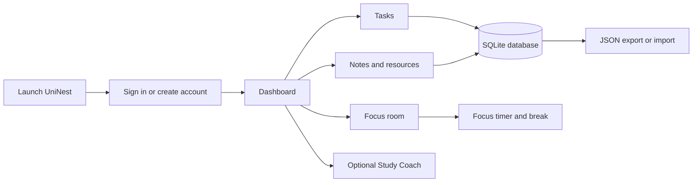

# UniNest — Personal Study Planner

UniNest is a personal study workspace for turning schoolwork into manageable next steps. It brings task planning, notes, useful links, and focused study sessions together in one calm interface. The app runs locally on your computer and saves each account’s planner data in SQLite.

## What’s included

### Overview

- Dashboard with task progress, completed and pending counts, note/resource totals, and a quick-add task field.
- Shortcuts to your tasks and Focus room.

### Tasks

- Create, complete, and delete tasks.
- Set a priority, optional due date, and estimated study time.
- Search and filter the list by all, pending, or completed tasks.
- Select an unfinished task in Focus room to keep your current goal visible.

### Notes and resources

- Save and delete notes for class ideas, reminders, and revision material.
- Keep links in a resource shelf and label them as links, PDFs, videos, articles, or tools.

### Focus room

- Focus sessions of 15, 25, or 50 minutes.
- A five-minute break starts when a focus session finishes; the break can be paused, reset, or skipped.
- A completion chime plays at the end of a focus session or break when sounds are enabled.
- Choose a task to focus on, and use the full-screen timer for a distraction-reduced view.

### Personalization and accounts

- Register, sign in, edit your name and email, and change your password.
- Warm dark and light themes, with page transitions and animated decorative artwork.
- Settings to switch interface sounds, animations, and motion blur on or off, and adjust blur strength.
- Button sounds are generated in the browser; no audio files are required. Sound and motion preferences are saved to the signed-in account.

### Export and import

- Export planner tasks, notes, resources, theme, and display preferences to a JSON backup.
- Import a UniNest JSON backup. Imported records are added to the current account; existing records are kept.
- Backups do not include passwords, account details, the Gemini key, or the current timer countdown.

### Study Coach — still in progress

The optional Study Coach is being developed to make a gentler plan from your unfinished tasks, available study time, and stress check-in. It uses Gemini when configured. The app asks for consent before sending those planning details to the AI service. Notes, resources, name, and email are not sent. A generated plan is only saved if you choose to save it to Notes. Without AI configuration, the rest of the planner remains available.

## How the app works



## Technology

- **Server and application logic:** Python with Flask
- **Database:** SQLite
- **Browser interface:** HTML, CSS, and JavaScript
- **Python package:** Flask, listed in `requirements.txt`

Python runs the local web server and handles authentication, database operations, exports, imports, and Study Coach requests. HTML, CSS, and JavaScript provide the browser interface and its interactive behavior. No separate database server or front-end build step is needed.

## Project files

```text
PQC_Project/
├── app.py                 Flask routes, account logic, SQLite access, import/export, Study Coach
├── main.py                Starts the local server and opens the browser
├── legacy_desktop.py      Earlier desktop prototype; not used by the current web launchers
├── requirements.txt       Python dependencies
├── run_app.bat            Starts your regular planner
├── run_demo.bat           Starts the sample-data presentation version
├── templates/
│   ├── auth.html          Sign-in and registration screen
│   └── index.html         Main planner pages
└── static/
    ├── app.css            Planner layout, themes, artwork, responsive styles, and motion
    ├── app.js             Planner interactions, timer, sounds, and browser-side logic
    ├── auth.css           Sign-in and registration styling
    └── auth.js            Sign-in and registration interactions
```

The regular and demo SQLite databases are created locally when needed and are not source-code files. The virtual environment, session secret, database files, and exported backup files are excluded from Git by `.gitignore`.

## Requirements

- Windows 10 or 11
- Python 3.10 or newer available on PATH
- A modern browser such as Chrome, Edge, or Firefox
- Internet access on first launch so the launcher can install Flask

After Flask is installed, the planner and its data run locally. No Gemini key is needed for normal planner features.

## Run the planner

1. Double-click `run_app.bat`.
2. On the first launch, the launcher creates a virtual environment and installs Flask.
3. A browser opens to the local planner. Create an account or sign in.
4. Keep the terminal window open while using UniNest. Close it to stop the server.

To start it manually in PowerShell:

```powershell
python -m venv .venv
.venv\Scripts\Activate.ps1
python -m pip install -r requirements.txt
python main.py
```

## Run the classroom demo

Double-click `run_demo.bat`. The presentation launcher uses a separate demo database and provides sample data with a one-click demo sign-in. Changes made during the demo stay in the demo database and do not alter your regular planner database.

## Data and privacy

- Regular planner data is stored in `study_planner.db` in the project folder.
- The demo uses `study_planner_demo.db`.
- Tasks, notes, resources, settings, and accounts are stored locally; planner records are associated with their account.
- Passwords are stored as password hashes.
- JSON backups include planner records, theme, and interface preferences, but exclude credentials and account information.
- Keep a separate copy of important data using Export or by backing up the database while the app is stopped.

### Optional Study Coach setup

Study Coach can use a Gemini API key. You can connect a key in the Study Coach page; it is held in server memory and cleared when UniNest stops. It is not written to the database or included in JSON exports. Alternatively, configure the `GEMINI_API_KEY` environment variable before launching the app. Do not put API keys, passwords, or other secrets in this README or commit them to the project.

Study Coach is still being worked on. Its suggestions are for study planning, not medical advice or therapy.

## Suggested presentation flow

1. Sign in to the demo workspace and show the Overview dashboard.
2. Add a task with a priority, due date, and study estimate; then complete it.
3. Save a note and a study resource.
4. Open Focus room, select a task, show the timer presets and full-screen control, then explain the automatic break and skip option.
5. Switch the theme and show the sound, animation, and motion-blur settings.
6. Demonstrate JSON export and import, and explain that import adds records without replacing current data.
7. Introduce Study Coach as an optional feature still in progress, including its consent and privacy behavior.
