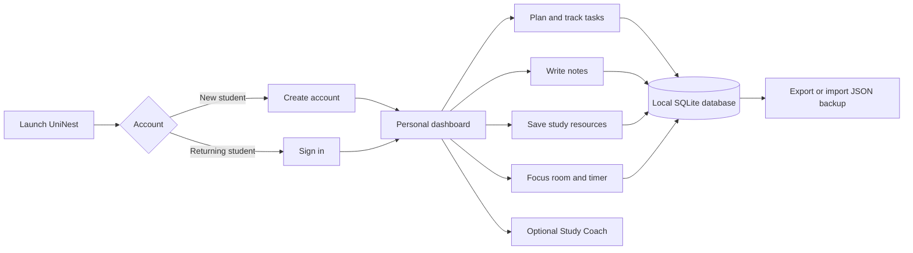

# UniNest — Personal Study Planner

UniNest is a personal workspace for planning study tasks, collecting notes and useful resources, and protecting focused study time. It is designed for one student to manage their work in a calm, organized place.

## How the app flows



### Typical student workflow

1. Start the app and create an account, or sign in.
2. Review the dashboard for progress and upcoming tasks.
3. Add study tasks, set their priority, and mark them complete as you work.
4. Capture useful ideas in Notes and keep links in Resources.
5. Open Focus room, choose a session length, and start the timer.
6. Export a JSON backup, or import a previous backup to add its planner data.
7. Update your profile or password from **My account**.

## Main features

- Dashboard with task progress, quick task entry, and an overview of saved work
- Task list with priority, completion, search, filters, and deletion
- Notes and a study resource shelf
- Focus timer with 15, 25, and 50 minute sessions
- Study Coach (in progress): optional Gemini-assisted planning around available time and stress check-ins
- Optional due dates and study-time estimates to help prioritize tasks
- Account registration, sign-in, profile editing, and password changes
- Warm dark and light themes, animated page transitions, and theme-aware artwork
- Button sounds, a theme-tinted arrow cursor, and reduced-motion support
- JSON export and import; imported tasks, notes, and resources are added to the current planner
- Local-first storage using SQLite, with planner records separated by account

Study Coach is still being developed. When connected, it asks for consent before sharing unfinished-task details, available time, and the stress check-in with Gemini. It never sends notes, resources, account name, or email. Treat generated plans as drafts; choose **Save plan to Notes** if you want to keep one. Without optional AI configuration, the rest of UniNest works as usual.

## Technology

- **Backend:** Python and Flask
- **Database:** SQLite, included with Python
- **Browser interface:** HTML, CSS, and JavaScript
- **Dependency:** Flask (listed in `requirements.txt`)

Flask renders the pages and handles browser requests to read and update planner data. SQLite stores accounts, tasks, notes, resources, and theme preference on this computer. Passwords are stored as hashes.

## What you need

- Windows 10 or 11
- Python 3.10 or newer installed and available on PATH
- Internet access on the first launch so the launcher can install Flask; after setup, the planner data and app run locally
- A modern browser such as Chrome, Edge, or Firefox

No separate database server or front-end build tools are required.

### Study Coach setup

Study Coach is optional and uses Gemini. Paste your Gemini key into the setup card in UniNest; it stays in server memory until UniNest stops and is not added to account data or JSON exports. The Gemini connection and plan generation are still being refined, so the feature may change. Never add credentials or secret configuration files to this README or commit them to the project. The planner works without Study Coach.

## Run UniNest

1. Double-click `run_app.bat`.
2. On the first launch, the script creates `.venv` and installs Flask.
3. UniNest opens at <http://127.0.0.1:8000>.
4. Create an account to begin. Keep the terminal window open while using the app; close it to stop the server.

To run from a terminal instead:

```powershell
python -m venv .venv
.venv\Scripts\Activate.ps1
python -m pip install -r requirements.txt
python main.py
```

## Classroom demo

Double-click `run_demo.bat` to open the presentation version. It uses `study_planner_demo.db`, separate from the regular `study_planner.db`, and supplies sample study data. Select **Explore the demo space** on the sign-in page for one-click access. Changes made in the demo stay in the demo database.

## Data and backups

- Regular accounts and planner records are stored in `study_planner.db` beside the app.
- The demo launcher uses `study_planner_demo.db` instead.
- Use **Export** to download a JSON backup of tasks, notes, resources, and theme.
- Use **Import** to add those records from a UniNest JSON backup. Existing planner entries are kept; account credentials are not included in the backup.
- Keep a copy of the database or JSON export somewhere safe if the planner data matters.

## Before presenting

- Start with `run_demo.bat` and use the sample workspace to demonstrate the app.
- Show the task workflow, notes, resources, focus timer, theme switch, account page, and JSON export/import.
- Explain the local flow: Flask handles requests, SQLite stores the data, and the browser interface presents the planner.
- Keep the regular planner database separate from the demo database.
